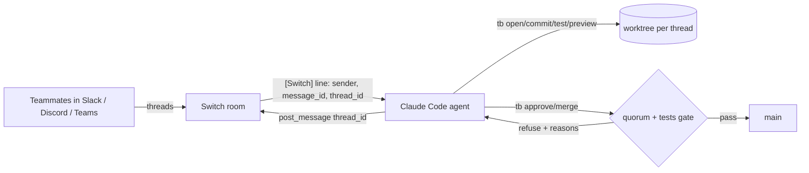

# threadbranch

**Every chat thread is a git branch.**

Your team already talks about changes in Slack or Discord threads. threadbranch puts a coding agent into that channel through [Switch](https://github.com/sandbox-quantum/switch), and every top-level message becomes its own branch, worktree and live preview. Teammates steer the change by replying in the thread. The change merges only when enough *other* people reply `approve` and the tests pass on the latest commit, and that rule is enforced by code, not by the prompt.

```
#acme-threads
├─ priya: @tb validate email format on signup           → thread/validate-email-format-k3j9a1   :4100
│   ├─ tb: done · 2 files · preview http://…:4100 · approvals 0/2
│   ├─ sam: also reject emails without a dot in the domain
│   ├─ tb: updated · earlier approvals cleared
│   ├─ sam: approve        ✔ 1/2
│   ├─ lee: approve        ✔ 2/2
│   └─ lee: ship           → merged into main (approved by sam, lee)
└─ lee: @tb make the button green                       → thread/make-the-button-green-p0x2b7   :4101
```

## Why

- **Parallel by default.** Three threads are three isolated worktrees. Work never mixes, and you never `git stash`.
- **The conversation is the code review.** Requests, revisions, approvals and the merge all live in one thread that anyone can scroll.
- **Safe enough for a real team.** Agents shouldn't approve their own work. `tb` keeps a quorum, invalidates approvals when the code changes, requires green tests, and writes an audit log.

## How it works



1. **Switch** bridges the channel to an agent session. Each message carries the sender, its `message_id`, and its `thread_id`.
2. The **agent** (Claude Code, Codex or OpenCode) follows the operating rules in [`switch/threadbranch.template.yaml`](switch/threadbranch.template.yaml). The thread's root message id is the key for everything.
3. **`tb`** is a small CLI the agent drives. It owns the branch, worktree, preview port, approvals, test results, merge and audit trail, so the guarantees don't depend on the model behaving.

Without Switch there is no thread identity, no sender identity and no channel. The project doesn't work without it.

## The gate

`tb merge` refuses unless all of these are true:

| Rule | Why |
|---|---|
| At least `approvalsRequired` (default 2) distinct people approved | No single person, or agent, ships alone |
| Approvals are for the **current** commit | Changing code after review clears the approvals |
| The person who opened the thread doesn't count | Nobody reviews their own request. Teammates who only asked for follow-up changes in the thread can still approve. |
| `testCommand` passed on the current commit, run on a clean tree | Green tests on exactly what ships (runs with uncommitted changes aren't recorded) |
| No uncommitted changes, worktree on its thread branch, main checkout clean and on `base` | No surprise state; the merge lands exactly the approved commit |

Names are compared after normalization (case, leading `@`, Unicode compatibility forms, zero-width characters, whitespace), and empty names are rejected. An invalid `.tb/config.json`, such as `approvalsRequired: 0`, makes `tb` refuse to run instead of weakening the gate.

When it refuses, it lists the blockers and the agent posts them verbatim. Every action is appended to `.tb/audit.jsonl` (see `tb log`).

## Setup (≈15 min)

Requirements: Node 20+, git, [Docker](https://docs.docker.com/get-started/get-docker/), [Switch Console](https://docs.switchagents.ai/switch-rooms/getting-started), and Claude Code (`claude auth login`), Codex or OpenCode.

```sh
git clone https://github.com/Chandan11232/threadbranch.git && cd threadbranch
npm link                      # puts `tb` on your PATH
npm test                      # quorum, stale approvals, test gate, merge, revert, preview, edge cases
scripts/setup-demo.sh ~/threadbranch-demo     # demo repo with `tb init` already run
```

Then in Switch Console:

1. **Add a server**: run one on this computer (comes with Mattermost), or connect Slack or Discord under *Messaging apps*. Slack and Discord show threads best.
2. **Restart Switch Console** so it picks up `tb` on your PATH.
3. **Templates → New**: paste `switch/threadbranch.template.yaml`. Set *Repository path* to `~/threadbranch-demo` as an absolute path, then **Create agent and room**.
4. Invite your teammates to the `tb-threads` channel. Optionally run `!assign-agent @tb` so follow-ups in the room reach the agent without an `@`.

### Using your own repo

```sh
cd your-repo
tb init --approvals 2                 # or --no-tests, --no-preview, --pr, --tunnel cloudflared
```

`.tb/config.json`:

| Key | Default | |
|---|---|---|
| `base` | current branch | branch threads start from and merge into |
| `approvalsRequired` | `2` | distinct approvers needed |
| `selfApproveCounts` | `false` | whether the requester's own approval counts |
| `testCommand` | `npm test` | `null` turns off the test gate |
| `previewCommand` | `npm start` | started with `PORT` set; `null` turns previews off |
| `previewTunnel` | `none` | `cloudflared` gives each preview a public `trycloudflare.com` URL teammates can open |
| `mergeMode` | `merge` | `pr` pushes the branch and merges through a GitHub PR with `gh` |

## Demo script (for the video)

1. Priya posts: `@tb signup should reject invalid emails`. The agent replies in a new thread with a summary, diff and preview link.
2. Lee, at the same time, posts at the top level: `@tb make the sign-up button green`. That opens a second thread and branch, isolated from the first.
3. In thread 1, Sam asks for a follow-up: `also show the error in red`. The agent commits again and says earlier approvals were cleared.
4. Priya replies `approve`. **Refused:** you can't approve your own request.
5. Sam replies `ship`. **Refused:** 1/2 approvals. Lee replies `approve`, then `ship`. **Merged.**
6. Someone posts `@tb board` at the top level to show both threads and their states.
7. Bonus: reply `revert` in the merged thread and it's undone in one message.

## CLI reference

```
tb init | open | where | commit | diff | test | preview | approve | unapprove
   check | merge | sync | revert | close | board | log
tb user add | user rm | user unlock | login | logout | whoami
```

Run `tb help` for flags. `<thread>` accepts the Switch thread id, the branch key (`validate-email-k3j9a1`) or the branch name.

## Auth

`tb` has local logins backed by signed tokens (HS256 JWTs). No extra dependencies, and `tb init` is not required.

**Secret.** Login commands need `TB_JWT_SECRET`, at least 32 bytes. There is no default. Generate one with:

```sh
export TB_JWT_SECRET="$(node -e "console.log(require('crypto').randomBytes(32).toString('base64url'))")"
```

Keep it out of the repo. Changing it invalidates every token issued so far.

**Commands.**

```
tb user add <name>   create a login; asks for the password twice (or reads one line from stdin)
tb user rm <name>    delete a login; its tokens stop working
tb user unlock <name>  clear failed logins and any lockout for a login
tb login <name>      check the password and store a token for this checkout
tb whoami            print who is logged in and until when
tb logout            revoke every token of the logged-in user and forget the local one
```

Passwords are typed at a hidden prompt, or read from the first line of stdin when it is not a terminal (`tb login sam < pwfile`, with `pwfile` mode `0600`). They are never accepted as arguments, because arguments end up in shell history and `ps`. Usernames are case-insensitive (`a-z 0-9 . _ -`, up to 64). Passwords need at least 8 characters, and can be at most 1024 bytes.

**Tokens.** A token lasts 1 hour. It is rejected once it expires, after `tb logout` (which revokes all of that user's tokens, on every checkout), or after `tb user rm`. Re-creating a deleted user does not bring old tokens back. Every rejection gives the same message: `not authenticated: invalid, expired or revoked token`. Set `TB_DEBUG=1` to also print the specific reason.

**Lockout.** Five failed logins in a row lock the name for 1 minute. Each further failure after that doubles the lock, up to 24 hours. A successful login resets the count, and the count is forgotten after 24 hours of quiet. While locked, `tb login` fails with the usual `invalid username or password` without checking the password, so guesses during a lock reveal nothing. Unknown names are throttled exactly like real ones. Anyone who can run `tb login` can lock out a name this way. That's the trade-off of a lockout. `tb user unlock <name>` clears it.

**Files.** Everything lives in the repository's git directory, shared by all its worktrees and never committed:

- `.git/tb-auth/users.json` holds scrypt password hashes with a salt per user, plus login-throttle state. Mode `0600`.
- `.git/tb-auth/token` holds the current token. Mode `0600`. It is shared by every worktree of the repository: logging in from one worktree logs in all of them, and `tb logout` logs out all of them.

Writes go through a lockfile (`users.json.lock`), so concurrent `tb` processes won't lose updates in normal use. A lock left by a crashed process is cleared automatically.

**Trust model.** This guards a shared checkout against casual misuse. It is not a security boundary against anyone who can run `tb` in the repository, or otherwise write `.git/tb-auth/`. Such a person can add users or edit the file directly, which is why `tb user add`/`rm` need no login. It also means they can become anyone: `tb user rm sam && tb user add sam` followed by `tb login sam` works. So `tb whoami` identifies a user only among people who cannot write `.git/tb-auth/`. Don't treat it as proof of identity against anyone else.

Logging in writes `.git/tb-auth/users.json` (to count attempts), so it needs write access there. A read-only store refuses every login.

## Limits

- The login lockout table is bounded (1,000 names). An attacker who can make thousands of attempts can push a lock record out, so treat the lockout as rate limiting, not a guarantee.

- Switch doesn't pass emoji reactions to agents, so approvals are thread replies (`approve`, `ship`).
- One agent session works through messages in order. Threads are isolated, but builds run one after another.
- Approver identity is the sender name Switch reports to the agent. `tb` trusts what the agent passes in, and the agent's instructions forbid recording approvals for anyone but the sender. Treat this as a team workflow guard, not a security boundary. Name normalization folds case, `@`, Unicode compatibility forms and zero-width characters, but not look-alike letters from other scripts (Cyrillic `а` vs Latin `a`).

## License

MIT
